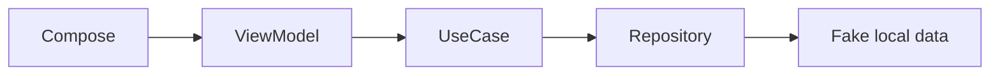

# POC Architecture — Finance POC

Runnable Android POC with 3 screens: dashboard overview, expense list, and budgets. Clean Architecture + Compose. Fake data for demo.

**Figma:** https://www.figma.com/design/Ysn4BBvXbVvpBmmMC7nxBz/poc

**Requirements:** Finance POC: Dashboard with spend summary, Transactions list, and Budgets list. Fake data is fine.

## Screens (executed)

- **Dashboard** (`dashboard`) — Overview of spend vs budget

- **Transactions** (`transactions`) — Recent expenses

- **Budgets** (`budgets`) — Monthly budgets

## Design system (V3)

- Primary: `#0F766E`
- Spacing unit: 8dp
- Corner radius: 16dp
- Notes: Teal finance POC tokens inspired by Figma brand frame

Shared components live in `core:ui` (`PocTopBar`, `PocListCard`, loading/empty/error).

## Modules

- `app` (app) — Shell + navigation

- `core/common` (core) — Shared primitives

- `core/network` (core) — Retrofit-ready

- `core/database` (core) — Room-ready

- `core/ui` (core) — Material 3 theme

- `features/dashboard` (feature) — Home overview

- `features/transactions` (feature) — Expense list

- `features/budgets` (feature) — Budget list

## Data flow

## Tech

- **di:** Hilt

- **network:** Retrofit+OkHttp

- **db:** Room

- **ui:** Jetpack Compose+Material3

- **navigation:** Navigation Compose

- **async:** Coroutines+StateFlow
