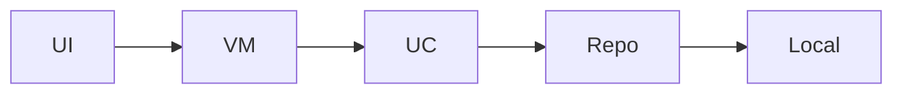

# POC Architecture — AI Personal Expense Assistant

Wire existing screens into bottom navigation: add_expense, analytics, history

**Figma:** https://www.figma.com/design/Ysn4BBvXbVvpBmmMC7nxBz/AI-Personal-Expense-Assistant?node-id=0-1&p=f&t=BXhIL10A7On3kmp3-0

**Requirements:** add expenses to the bottom navigation

## Screens (executed)

- **AddExpense** (`add_expense`) — Existing host feature: add_expense

- **Analytics** (`analytics`) — Existing host feature: analytics

- **History** (`history`) — Existing host feature: history

## Design system (V3)

- Primary: `#8B5CF6`
- Spacing unit: 8dp
- Corner radius: 16dp
- Notes: Imported from Figma file_content

Shared components live in `core:ui` (`PocTopBar`, `PocListCard`, loading/empty/error).

## Modules

- `features/add_expense` (feature) — Existing host feature: add_expense

- `features/analytics` (feature) — Existing host feature: analytics

- `features/history` (feature) — Existing host feature: history

## Data flow

## Tech

- **di:** Hilt

- **network:** Retrofit+OkHttp

- **db:** Room

- **ui:** Jetpack Compose+Material3

- **navigation:** Navigation Compose

- **async:** Coroutines+StateFlow

- **generation_mode:** wire existing screens into bottom nav

- **host_compat:** Compose + Hilt detected — full integrate

- **skipped_existing_features:** home, expenses
