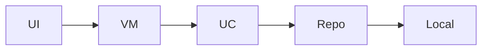

# POC Architecture — Splash Dashboard POC

Runnable Compose POC generated from your brief (3 screen(s): splash, dashboard, show_it_for_3_sec).

**Figma:** https://www.figma.com/design/Ysn4BBvXbVvpBmmMC7nxBz/poc

**Requirements:** Finance app , Create a splash screen, show it for 3 sec , create a dashboard screen , analysis screen

## Screens (executed)

- **Splash** (`splash`) — Splash screen from brief

- **Dashboard** (`dashboard`) — Dashboard screen from brief

- **ShowItFor3Sec** (`show_it_for_3_sec`) — ShowItFor3Sec screen from brief

## Design system (V3)

- Primary: `#8B5CF6`
- Spacing unit: 8dp
- Corner radius: 16dp
- Notes: Imported from Figma file_content

Shared components live in `core:ui` (`PocTopBar`, `PocListCard`, loading/empty/error).

## Modules

- `app` (app) — Shell + navigation

- `core/common` (core) — Shared primitives

- `core/ui` (core) — Design system

- `features/splash` (feature) — Splash screen from brief

- `features/dashboard` (feature) — Dashboard screen from brief

- `features/show_it_for_3_sec` (feature) — ShowItFor3Sec screen from brief

## Data flow

## Tech

- **di:** Hilt

- **ui:** Jetpack Compose+Material3

- **navigation:** Navigation Compose

- **async:** Coroutines+StateFlow

- **planning:** brief-driven (no LLM)
