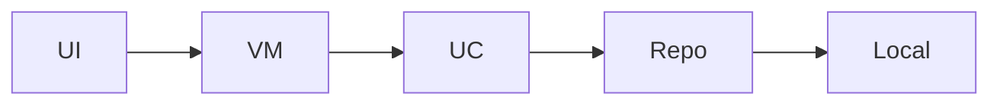

# POC Architecture — AI Finance POC

A two-screen expense POC: capture new expenses on Add Expense and review spending summaries on Analytics, with Navigation Compose moving between both. Local fake expense data only; Figma informs layout and tokens.

**Figma:** https://www.figma.com/design/Ysn4BBvXbVvpBmmMC7nxBz/AI-Personal-Expense-Assistant?node-id=0-1&p=f&t=BXhIL10A7On3kmp3-0

**Requirements:** AI Finance app with Add Expense Screen and Analytics Screen and navigation in these screen

## Screens (executed)

- **Add Expense** (`addexpense`) — Form to enter amount, category, note, and date; saves to local store and refreshes analytics source.

- **Analytics** (`analytics`) — Dashboard of totals, category breakdown, and recent transactions from local expenses.

## Design system (V3)

- Primary: `#8B5CF6`
- Spacing unit: 8dp
- Corner radius: 16dp
- Notes: Imported from Figma file_content

Shared components live in `core:ui` (`PocTopBar`, `PocListCard`, loading/empty/error).

## Modules

- `app` (app) — Application shell, NavHost, bottom navigation between Add Expense and Analytics

- `core/common` (core) — Shared result types, dispatchers, extensions

- `core/network` (core) — Retrofit-ready scaffolding (unused in POC)

- `core/database` (core) — Room-ready scaffolding (optional in-memory/local JSON for POC)

- `core/ui` (core) — Design system: colors, typography, spacing, buttons, text fields, expense list row

- `features/addexpense` (feature) — Add and persist expense entries

- `features/analytics` (feature) — Aggregate and display spending analytics

## Data flow

## Tech

- **di:** Hilt

- **network:** Retrofit+OkHttp

- **db:** Room

- **ui:** Jetpack Compose+Material3

- **navigation:** Navigation Compose

- **async:** Coroutines+StateFlow
