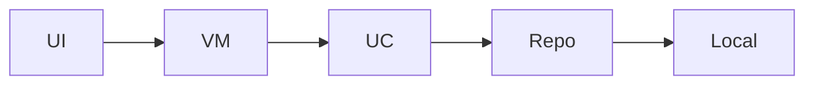

# POC Architecture — AI Finance POC

A two-screen expense POC: capture new spending on Add Expense and review totals and trends on Analytics, with Navigation Compose routes and tap handlers for submit, category pick, and chart or list drill-down. Uses local fake transactions aligned with the AI Personal Expense Assistant Figma flow.

**Figma:** https://www.figma.com/design/Ysn4BBvXbVvpBmmMC7nxBz/AI-Personal-Expense-Assistant?node-id=0-1&p=f&t=BXhIL10A7On3kmp3-0

**Requirements:** Ai Finance App with AddExpense Screen , Analytics Screen and proper navigation in these two also handle click listeners as well

## Screens (executed)

- **Add Expense** (`add_expense`) — User enters amount, category, note, and date; Save persists locally and navigates or shows success; category chips and View Analytics link handle clicks.

- **Analytics** (`analytics`) — Shows month total, category breakdown, and recent expenses; period and category row clicks filter or highlight slices.

## Design system (V3)

- Primary: `#8B5CF6`
- Spacing unit: 8dp
- Corner radius: 16dp
- Notes: Imported from Figma file_content

Shared components live in `core:ui` (`PocTopBar`, `PocListCard`, loading/empty/error).

## Modules

- `app` (app) — Hilt application, NavHost, bottom or top-level graph linking Add Expense and Analytics

- `core/common` (core) — Result types, dispatchers, date and money formatting

- `core/network` (core) — Retrofit-ready stubs for future AI categorization API

- `core/database` (core) — Room-ready placeholder; POC uses in-memory local source

- `core/ui` (core) — Material 3 theme, spacing, ExpenseAmountField, CategoryChipRow, SummaryCard

- `features/add_expense` (feature) — Expense entry form and save flow

- `features/analytics` (feature) — Spending analytics and category breakdown

## Data flow

## Tech

- **di:** Hilt

- **network:** Retrofit+OkHttp

- **db:** Room

- **ui:** Jetpack Compose+Material3

- **navigation:** Navigation Compose

- **async:** Coroutines+StateFlow
